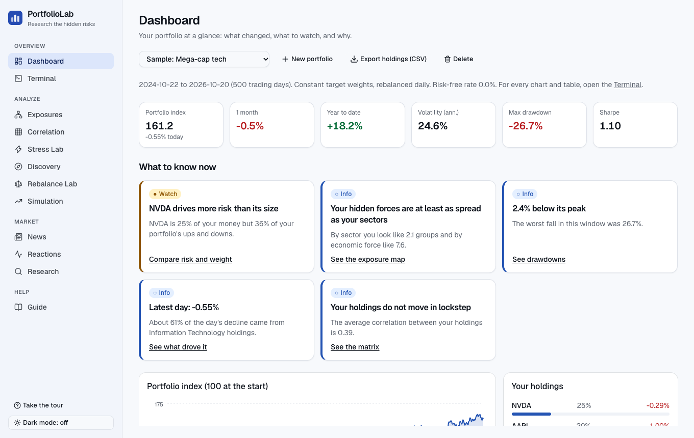
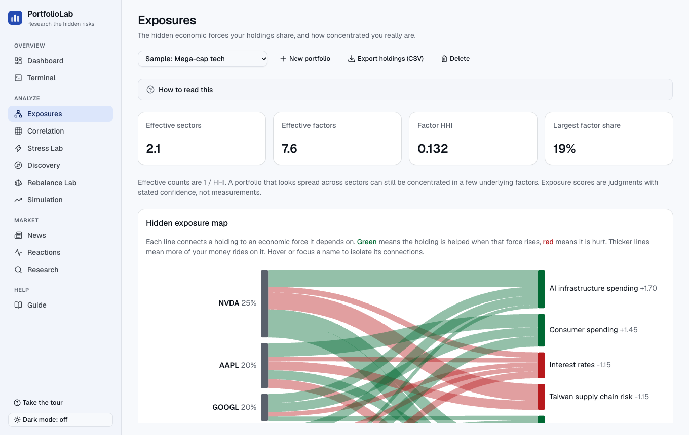
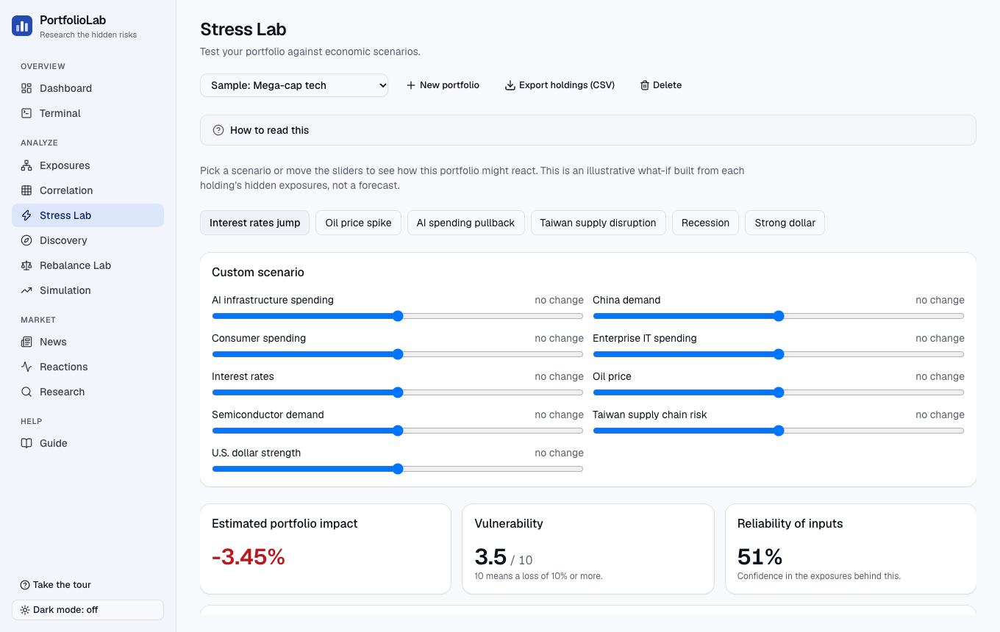
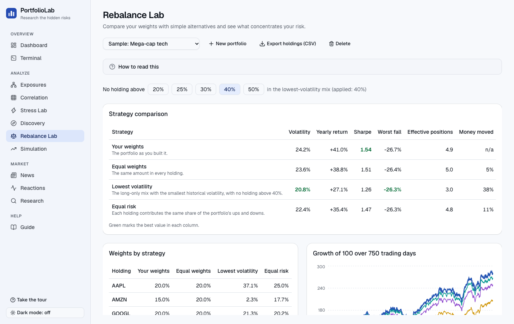
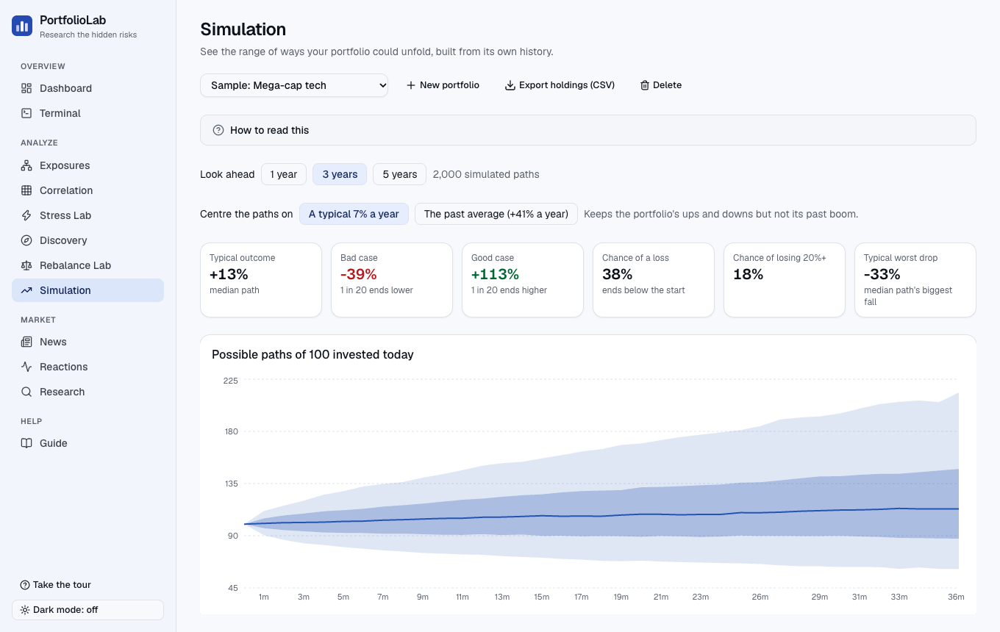
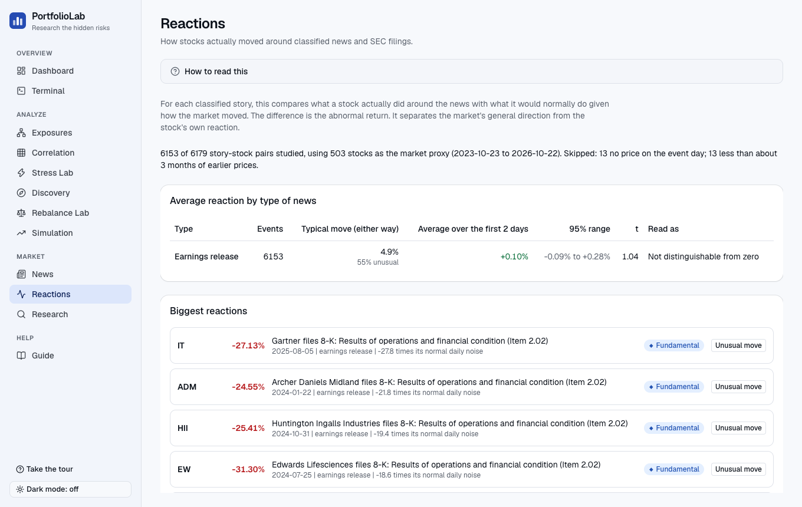

# PortfolioLab AI

A research terminal built around one idea: owning different stocks does not mean owning different risks. PortfolioLab connects a portfolio to the hidden economic forces behind its holdings, ranks the news that matters to it, measures how stocks really reacted to events, and explains results in plain language with every number traceable to a computed figure.

|                                                |                                                        |
| ---------------------------------------------- | ------------------------------------------------------ |
|    |  |
|      |        |
|  |            |

Start with `docs/OVERVIEW.md` for what it does, how it works and how it was checked. Product description: `description.md`. Plan: `ROADMAP.md`. Decisions in plain language: `docs/DECISIONS.md` (short technical notes in `docs/adr`).

## Local setup

Requires Node 22, pnpm, Docker, and uv (for `services/analytics`).

```sh
cp .env.example .env
pnpm install
pnpm db:up          # Postgres on localhost:54330
pnpm db:migrate
pnpm db:seed        # development fixtures only
pnpm data:sp500     # load the committed S&P 500 snapshot (add --refresh to re-fetch)
pnpm data:ingest --provider fixture   # synthetic prices; use --provider tiingo with a key, --limit N to stage
pnpm --filter @portfolio-lab/web dev
```

The analytics service: `cd services/analytics && uv sync && uv run uvicorn analytics.main:app --reload`.

## Checks

`pnpm format:check && pnpm lint && pnpm typecheck && pnpm test` (DB tests need `DATABASE_URL` pointing at a running Postgres; they create and drop their own databases).

## Try the app with demo data

`pnpm demo` builds a separate `pl_demo` database (the S&P 500 list, prices for 24 companies, 12 economic factors with
exposures, and 30 labelled news items) and starts the app on http://localhost:3000 with a "demo mode" banner. The five sample portfolios are
loaded for you automatically on your first visit. Open **Guide** for a five-minute tour. Everything in the demo
is made up and clearly marked; it never touches your real dev database.

## End-to-end tests

`pnpm --filter @portfolio-lab/web e2e` rebuilds the app, creates a fresh `pl_e2e` database (migrations, the S&P 500
universe, deterministic fixture prices, a small exposure fixture), starts the production server and a local mock of
the OpenAI API, then runs the Playwright suite in desktop and mobile Chrome. It never calls the real OpenAI API.
Use `e2e:run` to skip the rebuild. Tests run one at a time because the mock holds a single global mode. Requires
Google Chrome and a running Postgres (`pnpm db:up`).

## Layout

- `apps/web` Next.js app and API route handlers
- `packages/db` Drizzle schema, migrations, seed
- `packages/shared` shared types and env validation
- `services/analytics` Python FastAPI service

## Research study module

Off by default. Set `EXPERIMENT_ENABLED=1`, `EXPERIMENT_ADMIN_TOKEN` (16+ characters) and optionally `EXPERIMENT_UNIVERSE` (comma-separated tickers) to open `/experiment`. Enrolled participants are confined to the study. Do not enable it for real participants before ethics approval; see `docs/experiment-design.md`. Researcher endpoints: `GET /api/experiment/export` (CSV) and `GET /api/experiment/results` (analysis), with the token in an `x-admin-token` header.

## Real data

Free, no keys. Needs Postgres up (`pnpm db:up`) and `DATABASE_URL` in `.env`.

```
pnpm real:seed                      # S&P 500 prices (5 years, Yahoo) and illustrative exposures into database pl_real
SEC_USER_AGENT="Your Name you@school.edu" pnpm data:sec   # 8-K events and annual fundamentals from SEC EDGAR
pnpm real                           # app on http://localhost:3000 using pl_real
```

The price step takes about ten minutes and resumes if interrupted. Yahoo's endpoint is unofficial: use it for research only. The SEC asks for a User-Agent that identifies you.
