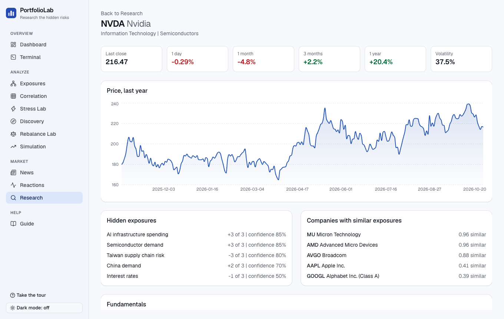
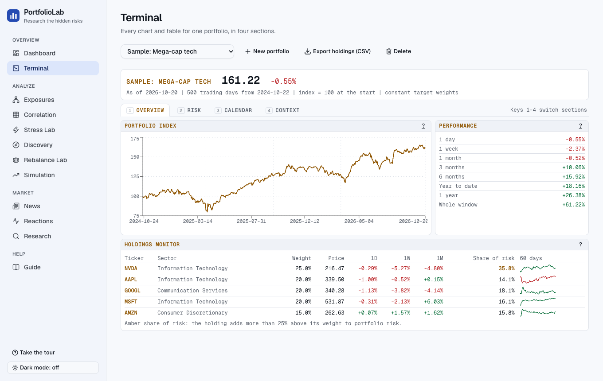

# PortfolioLab AI

**Owning different stocks does not mean owning different risks.** PortfolioLab shows you the hidden forces that your investments really depend on, which news actually matters to you, and how stocks have really reacted to events, then explains it all in plain English.

**Read the paper:** [Different Stocks, Same Risks? Measuring Hidden Economic Exposures in the S&P 500 with AI-Drafted Scores](docs/paper.pdf) (7 pages). Every number in it is produced by this code and checked by a separate Python implementation.

## What the research found

Measured on real data for all 503 S&P 500 companies (prices through 2026-10-20):

- **Sector spread tells you almost nothing about economic spread.** Across 2,000 random 10-stock portfolios, the correlation between how many sectors a portfolio spans and how many economic forces it depends on is 0.03. Portfolios spread across eight or more sectors are no better spread across forces than the rest.
- **The AI-drafted exposure scores carry real information.** Each day over a year, they explained 17.2% of the differences between stocks' returns, against 13.1% for sector labels, and did better on 65% of days.
- **Similar companies move together on news, beyond their sector.** On 121 earnings days of 11 large companies, stocks with similar exposures moved with the reporting company even after removing what sharing its sector explains (t = 4.38 with days in the same week counted once; none of 2,000 shuffled placebos came close). The effect is small.

**Still open, with the measurement built:** how often the AI's scores agree with a person who scores the same 33 companies without seeing them (the blind gold set), and whether showing people their hidden exposures changes how they build a portfolio (a randomized study, pre-registered, waiting for approval; see `docs/study-protocol.md`).

|                                                |                                                        |
| ---------------------------------------------- | ------------------------------------------------------ |
|    |  |
|      |        |
|  |            |
|   |              |

_The screenshots use real prices and SEC filings. The hidden-exposure scores are AI drafts that no person has reviewed yet, and the app says so wherever they appear._

---

## The idea in one minute

Imagine you own five well-known stocks in five different industries. That looks diversified. But suppose all five get hurt when interest rates rise, and four of them depend on one country's factories. In a bad month they could all fall together, even though you "own different things".

Most tools show you sectors, weights and past returns. PortfolioLab goes one step further. It links every company to the **economic forces** it depends on (interest rates, oil prices, China demand, AI spending and so on), then adds those links up across your portfolio. You get two numbers that tell the story:

- **Effective sectors**: how many groups you look spread across by industry.
- **Effective forces**: how many independent economic forces you are really exposed to.

The two numbers are measured on different scales, so compare each with what it could be, not with each other. The point is that the first does not predict the second: a portfolio can look well spread by sector and still rest on two or three forces, so the second number has to be measured.

## What you can do with it

| Page                    | What it answers                                                                                                                                                                                 |
| ----------------------- | ----------------------------------------------------------------------------------------------------------------------------------------------------------------------------------------------- |
| **Dashboard**           | What changed, and what should I watch? Plain-language cards, most important first.                                                                                                              |
| **Terminal**            | Every chart and table for one portfolio in four sections: performance, risk, calendar, context.                                                                                                 |
| **Exposures**           | Which hidden forces do my holdings share? An interactive map shows who is connected to what.                                                                                                    |
| **Correlation**         | How closely do my holdings move together, and does that get worse when markets fall?                                                                                                            |
| **Stress Lab**          | What if interest rates jump, oil spikes, or AI spending pulls back? Drag sliders and see the effect on each holding.                                                                            |
| **Discovery**           | Which companies would spread my hidden exposures across more forces?                                                                                                                            |
| **What the forces did** | Which hidden forces really moved stocks over the last year, and how much of my portfolio's return each explains. Also checks whether exposure scores describe stocks better than sector labels. |
| **Market comparison**   | How does my portfolio behave versus the S&P 500? Beta, alpha, tracking error, and how much of the market's good and bad days I take.                                                            |
| **Compare**             | Two of my portfolios side by side: performance, risk, hidden concentration and how much they overlap.                                                                                           |
| **Rebalance Lab**       | Would different weights have given a smoother ride? Compares your weights with simple alternatives.                                                                                             |
| **Simulation**          | What range of outcomes is normal? Thousands of possible futures built from your portfolio's own history.                                                                                        |
| **Watchlist**           | Companies I follow, with plain-language alerts: an unusual move, a sharp fall, or a price near its 52-week high or low.                                                                         |
| **News**                | Stories ranked by how much they matter to _you_, with a "why am I seeing this" breakdown.                                                                                                       |
| **Reactions**           | How did stocks actually move around earnings and SEC filings, after removing what the market did? Includes the pooled spillover test.                                                           |
| **Evidence**            | Does the idea hold up? Four claims tested on the real data right now, including how well the AI-drafted scores agree with a person's blind scores, each with a verdict and its limits.          |
| **Research**            | Look up any S&P 500 company, or ask the assistant a question about your portfolio.                                                                                                              |
| **Report**              | A one-page summary of a portfolio you can print or save as a PDF.                                                                                                                               |
| **Guide**               | Every term explained in plain language, plus a guided tour of the app.                                                                                                                          |

New here? The app opens with a short **guided tour**, a **getting-started checklist**, and a collapsed **"How to read this"** note on every page.

---

## Try it in five minutes (demo mode)

You need: **Node 22**, **pnpm**, and **Docker** (for the database).

```sh
git clone <this repository>
cd portfolio-lab
cp .env.example .env
pnpm install
pnpm db:up        # starts the database in Docker
pnpm demo         # builds a clearly-labelled made-up dataset and starts the app
```

Open **http://localhost:3000** (use `localhost`, not `127.0.0.1`). Five sample portfolios load for you on your first visit. To use your own holdings, go to **New portfolio** and paste a list or a broker export (percentages, dollar values or share counts all work).

Everything in demo mode is made up and marked as such. It lives in its own database (`pl_demo`) and never touches anything else.

The "In plain English" and assistant buttons use OpenAI. They work once you put an `OPENAI_API_KEY` in `.env`. Everything else works without any key.

## Use real data (free, no keys needed for the first two steps)

```sh
pnpm real:seed          # 5 years of real prices for all 503 S&P 500 companies (about 10 minutes)
SEC_USER_AGENT="Your Name you@school.edu" pnpm data:sec    # earnings filings and company financials from the SEC
pnpm data:exposures     # AI-drafted hidden-exposure scores for every company (needs OPENAI_API_KEY, about 500 calls)
pnpm real               # starts the app on real data at http://localhost:3000
```

Each step can be repeated safely and picks up where it stopped. Real data lives in its own database (`pl_real`), separate from the demo data.

**Where the data comes from**

- **Prices**: Yahoo Finance's public chart service. It is free but unofficial, so use it for research only.
- **Earnings events and financials**: SEC EDGAR (free, official). Each earnings filing is stamped with the exact second the SEC accepted it.
- **Hidden-exposure scores**: drafted by an AI model, clearly labelled "AI draft, not reviewed", and reviewable in the app (see below).

---

## How it works, in plain words

1. **Math first, words last.** Every number you see comes from ordinary, tested code. The AI never calculates anything. It only explains, classifies or summarizes.
2. **The AI is checked.** An explanation is built from a numbered list of facts. Every number in the answer must appear in that list, every citation must exist, and "buy" or "sell" advice is rejected. If an answer fails, it is retried once, then replaced by the plain figures. Made-up numbers never reach you.
3. **The assistant uses tools.** When you ask a question, it looks things up (portfolio summary, exposures, company data, news, stress tests) and may only quote what those tools returned. An answer given without looking anything up is rejected.
4. **Not advice.** PortfolioLab is a research tool. Pages say what they cannot show, and nothing tells you what to buy or sell.

### A few terms, simply

- **Hidden exposure**: an economic force that moves a company's value, whatever its sector label says.
- **Effective number**: how many _equally important_ things you really have. Ten stocks where one is half the portfolio might be only "3 effective" positions.
- **Abnormal return**: how a stock moved after removing what the whole market did that day. It isolates the stock's own reaction to news.
- **Volatility**: how bumpy the ride is. **Drawdown**: the fall from a peak to the next low.

---

## Does the idea hold up? A real test

When a large company reports earnings, do stocks with similar hidden exposures move the same way, more than stocks with different exposures do? Over 121 real earnings days for 11 large companies:

- The average correlation is **+0.059**.
- After removing what "same sector" explains, it is **+0.046**, so exposures add something the sector label does not.
- Earnings days in the same week are not independent, so they are counted once: 121 days become 70 independent weeks, and the result still holds (t = 4.38).
- A **placebo** reshuffles which stock gets which similarity score. Shuffled scores average zero; in the paper's run none of 2,000 shuffles matched the real figure.
- It is small, it varies by company, and the scores are AI drafts. The language model may also know, from its training text, which companies moved together in this period, so this shows the scores describe the period, not that they would have predicted it.

So this is evidence, not proof. The method and caveats are in [the paper](docs/paper.pdf) (section 4) and `docs/DECISIONS.md` (sections 26 and 30), and the live test is on the **Evidence** and **Reactions** pages.

---

## Settings (`.env`)

Copy `.env.example` to `.env`. Only the database URL is needed to start.

| Setting                  | What it does                                                                                                                |
| ------------------------ | --------------------------------------------------------------------------------------------------------------------------- |
| `DATABASE_URL`           | The Postgres database. The default works with `pnpm db:up`.                                                                 |
| `OPENAI_API_KEY`         | Turns on AI explanations, the assistant and exposure drafting. Never printed or committed.                                  |
| `SEC_USER_AGENT`         | Set on the command line for `pnpm data:sec`. The SEC asks for a name and email.                                             |
| `REVIEW_TOKEN`           | 16+ characters. Turns on the exposure review tool at `/review`. Leave empty to keep it off.                                 |
| `EXPERIMENT_ENABLED`     | `1` opens the research study at `/experiment`. Off by default. See the warning below.                                       |
| `EXPERIMENT_ADMIN_TOKEN` | 16+ characters. Protects the study's export and results, and signs participants' cookies.                                   |
| `EXPERIMENT_UNIVERSE`    | Optional comma-separated tickers the study participants choose from, or `gold` for the gold set.                            |
| `EXPERIMENT_PILOT`       | `1` marks new participants as pilot participants, reported apart from the main analysis.                                    |
| `STUDY_*`                | The approval details shown on the consent screen. The study enrols nobody until they are set; see `docs/study-protocol.md`. |
| Other `*_API_KEY`        | Optional paid or rate-limited data providers (Tiingo, Finnhub, Marketaux). Not needed.                                      |

## Two special tools (both off by default)

**Exposure review (`/review`)**: the AI-drafted exposure scores need a human check. This tool lists companies by status, lets a reviewer accept, edit, remove or add scores, and records who reviewed what and when. Every save is a new version and nothing is erased. The **gold set** filter (33 companies, `pnpm data:gold`) hides the AI draft so a person can score a company blind; the Evidence page then measures how far the drafts agree with those scores. Turn it on with `REVIEW_TOKEN`.

**Research study (`/experiment`)**: a built-in experiment that asks whether showing people their hidden exposures changes how they diversify. It has consent, random assignment to two groups, a control group that physically cannot reach exposure data, a data export, and a ready-made analysis. **Do not run it on real people until an ethics review has approved it.** The design, analysis plan and checklist are in `docs/experiment-design.md`; the document to give the approver, with the consent text, recruitment message and a parent or guardian form, is `docs/study-protocol.md`.

---

## Project map

```
apps/web          The website and its API (Next.js, TypeScript, Tailwind, Recharts)
packages/finance  All the math. Pure functions, no database, heavily tested
packages/data     Fetches prices, SEC filings and news; matches news to companies
packages/classify AI news classification and AI exposure drafting, with validation
packages/explain  AI explanations and the assistant, with the number-checking
packages/db       Database tables and migrations (Postgres, Drizzle)
packages/demo     Builds the demo dataset and the real-data database
packages/shared   Settings validation shared by everything
services/analytics A small Python service (health check only so far)
docs/             Plain-language decisions, design notes, screenshots
scripts/          The `pnpm demo` and `pnpm real` launchers
```

Developers: start with `docs/ARCHITECTURE.md`.

## Checking the code

```sh
pnpm format:check && pnpm lint && pnpm typecheck && pnpm test     # about 490 unit tests
pnpm --filter @portfolio-lab/web e2e                               # about 350 browser tests
pnpm paper                                                         # rebuild the paper from real data and re-check it in Python
pnpm --filter @portfolio-lab/web e2e:real                          # 16 read-only checks against the real-data database
```

The browser tests rebuild the app, create a fresh test database, and use a pretend OpenAI server, so they never spend money. They run in desktop and phone layouts and include accessibility scans in light and dark themes. They need Google Chrome and a running database.

Tests that need the database require `pnpm db:up`. The real-data checks need the real-data database to be built first (see "Use real data").

## If something goes wrong

- **"Connection refused" or tests fail to start**: the database is not running. Start Docker, then `pnpm db:up`.
- **The page stays on "Loading" in development**: open `http://localhost:3000`, not `http://127.0.0.1:3000`.
- **Port 54330**: the database uses it so it does not clash with other Postgres containers on 5432-5434.
- **AI buttons say "not configured"**: add `OPENAI_API_KEY` to `.env` and restart.

## Honest limitations

- Prices come from an unofficial free source. Use a licensed source before anything public or commercial.
- Hidden-exposure scores are judgments, not measurements. Most are AI drafts awaiting human review, and the 12-force list is a starting point. The model that drafted them may know how companies moved in the period tested (look-ahead), so the tests show the scores describe that period, not that they predict.
- Rebalance results look backwards and were fitted on the same period they describe. Simulations assume the future is as bumpy as the last three years.
- Event studies use an equal-weighted average of other S&P 500 stocks as "the market", not an official index.
- The research study has no approval yet. It refuses to enrol anyone until the approval details are configured.
- The CI workflow in `.github/workflows` is set up, but its first run (October 2026) was refused by GitHub because of an account billing or spending-limit issue, so every check so far was run locally. Fix the billing setting, then re-run it.

## More to read

- `docs/OVERVIEW.md`: what it does and how it was checked, for readers new to the project.
- `docs/ARCHITECTURE.md`: how the pieces fit, tables, routes and where each calculation lives.
- `docs/DECISIONS.md`: every decision in plain language, who made it, and every mistake found along the way.
- `docs/paper.pdf` and `paper/`: the research paper, the exported data behind every number in it, and the independent Python check.
- `docs/experiment-design.md`: the research study's design and ethics checklist.
- `docs/study-protocol.md`: the protocol to give the person approving the study, with the consent text, recruitment message and a parent or guardian form.
- `docs/factor-taxonomy.md` and `docs/event-taxonomy.md`: the lists of economic forces and event types (drafts awaiting review).
- `docs/adr/`: short technical decision records.
- `ROADMAP.md` and `description.md`: the original plan and product description.
